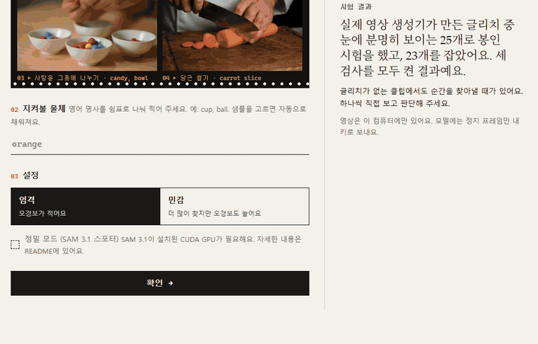

<div align="center">

# Lost & Frame

[English](README.md) · **한국어**

### AI 영상 생성기는 물체를 자주 놓칩니다. 아무도 건드리지 않은 머그잔이 탁자에 생기고, 벽난로의 장작이 다음 프레임에서 없어집니다.

### Lost & Frame은 물체가 까닭 없이 사라지거나 나타나는 순간을 찾습니다. 순간마다 비교할 프레임 두 장과 모델이 쓴 한 줄 설명이 붙습니다.



*저글링 샘플을 키 없이 엄격 설정으로 확인하는 장면입니다. 깜빡 비교를 누르면 98번과 102번 프레임이 번갈아 보입니다. 0.17초 사이에 오렌지 세 개가 하나가 됩니다.*

### AI 영상을 공개하는 사람, 그리고 영상 모델을 비교하거나 생성 클립을 거르는 팀을 위한 도구입니다. 5초 클립의 프레임 약 120장을 사람이 확인할 몇 개의 순간으로 줄입니다.

### 앱은 사용자의 컴퓨터에서 실행됩니다. 영상은 밖으로 나가지 않고, 모델에는 정지 프레임만 사용자의 키로 보냅니다. 키는 웹 페이지로 넘어가지 않습니다.

</div>

## 작동 방식

클립을 서로 다른 방식으로 살피는 세 가지 검사를 함께 씁니다. 세 검사는 놓치는 경우가 서로 다릅니다. 이 문서에서는 이 검사들을 증인이라고 부릅니다.

| 증인 | 하는 일 | 놓치는 것 |
|---|---|---|
| 장면 판정기 | 16프레임마다 Muse Spark가 ±15프레임 사이에서 고른 프레임 8장을 봅니다. 손, 화면 가장자리, 앞을 가리는 물건, 카메라 움직임, 장면 전환 같은 이유 없이 물체가 사라지거나 나타나거나 바뀌었는지 판단합니다. | 비슷한 물체가 많을 때 하나만 바뀐 경우를 놓칩니다. 실제 변화를 그럴듯하게 설명하고 넘어가기도 합니다. |
| 개수 판정기 | 같은 프레임을 보지만, 먼저 프레임마다 물체 개수를 셉니다. 머그잔이 세 개에서 두 개로 줄면 숫자로 남습니다. | 아예 보지 못한 물체는 셀 수 없습니다. |
| 스포터 (정밀 모드) | SAM 3.1의 탐지기를 추적 기억 없이 실행하고, SAM이 보통 버리는 약한 탐지까지 남겨서 물체 하나가 들어오거나 나간 자리를 찾습니다. 그 자리를 개수 판정기가 확대해서 다시 봅니다. 다른 두 증인이 아무것도 찾지 못한 곳에서만 실행됩니다. | GPU가 필요합니다. 늘어난 물체가 더 큰 물체와 붙으면 찾지 못합니다. |

증인은 충분히 확신할 때 경보를 냅니다. 기준은 엄격 설정이 90%, 민감 설정이 50%입니다. 5프레임 안에서 나온 같은 종류의 경보는 한 순간으로 묶습니다.

## 결과

시험 세트와 채점 규칙은 처음 실행하기 전에 정해 두었고(사전 등록), 세트마다 한 번만 채점했습니다. 숫자는 블라인드 육안 검토에서 프레임에 분명히 보인다고 표시한 글리치 가운데 민감 설정으로 잡은 수입니다.

| 시험 세트 | 장면 판정기만 | + 개수 판정기 | 세 증인 모두 |
|---|---|---|---|
| 실제 생성기 글리치 (Physion-Eval과 DeepTraceReward, 분명히 보이는 것 25개) | 20 (80%) | 22 (88%) | 23 (92%, 95% CI 74–99) |
| 실제, 보일 가능성이 높은 것 포함 (126개) | 75 (60%) | 92 (73%) | 99 (79%) |
| 처음 보는 클립에 복사 글리치를 넣은 것 (분명히 보이는 것 140개) | 131 (94%) | 134 (96%) | 135 (96%, 95% CI 92–99) |

Meta Model API 키를 쓰면 모델은 Muse Spark 1.3이 됩니다. 이 모델로도 따로 봉인 시험을 했습니다. 같은 실제 세트에서 분명히 보이는 글리치 25개 중 23개, 보일 가능성이 높은 것까지 126개 중 105개를 잡았고, 복사 세트에서는 140개 중 138개(98.6%)를 잡았습니다. 오경보는 Muse Spark Open보다 많았습니다.

### 한계

- 전문가가 표시한 글리치는 대부분 정지 프레임으로는 보이지 않습니다. 그런 글리치는 Lost & Frame도 우연 수준으로만 잡습니다.
- 글리치가 없는 새 클립 64개(Muse Spark 1.3)에서도 엄격 설정으로 클립의 52%에 순간이 하나 이상 나왔습니다. 클립당 약 1.2개입니다. 민감 설정에서는 70%였습니다. 반죽하는 손, 구름, 카메라 팬이 많았습니다. 글리치로 판단하기 전에 순간마다 직접 확인해야 합니다.
- 실제 글리치 25개는 작은 표본입니다. 95% 구간은 74%에서 99%까지입니다.

실패한 시도를 포함한 전체 기록은 [RESEARCH.md](RESEARCH.md)에 있습니다.

## 실행

Node.js 22.9 이상과 ffmpeg가 필요합니다. ffmpeg는 PATH에 있어야 하며, 그렇지 않으면 `ffmpeg.env` 파일에 `FFMPEG`와 `FFPROBE`를 적습니다. ffmpeg 설치 방법은 다음과 같습니다.

- Windows: `winget install Gyan.FFmpeg.Essentials` (설치 후 터미널을 새로 엽니다)
- macOS: `brew install ffmpeg`
- Debian, Ubuntu: `sudo apt install ffmpeg`

```bash
git clone https://github.com/YAMMYHONEY/lost-and-frame.git
cd lost-and-frame
node --env-file-if-exists=.env --env-file-if-exists=ffmpeg.env app.mjs
```

그다음 브라우저에서 <http://localhost:8787>을 엽니다. Windows에서는 `start-app.cmd`를 더블클릭해도 됩니다. 앱은 Node 표준 라이브러리만 쓰므로 npm으로 설치할 것이 없습니다. 화면 오른쪽 위에서 한국어와 영어를 바꿀 수 있습니다.

### 키 없이 실행

`.env` 파일이 없어도 샘플 4개는 확인할 수 있습니다. "또는 샘플 고르기"에서 하나를 고르고 확인을 누릅니다(영어 화면에서는 "or pick a sample"과 Check). 샘플에 대한 모델의 답은 `samples/raw`에 저장되어 있어서, 프레임 추출부터 리뷰 페이지까지 모델을 호출하지 않고 실행됩니다. 사용자의 클립을 넣으려면 키가 필요합니다.

샘플은 이 저장소를 위해 LTX-2.5(Lightricks)의 공식 Hugging Face Space에서 `research/ltx_samples.mjs`로 만든 5초 클립입니다. 프롬프트와 시드는 `samples/samples.json`에 있고, [LTX-2.x Community License](https://github.com/Lightricks/LTX-2/blob/main/LICENSE-2_x)를 따릅니다. 생성기가 자주 틀리는 장면, 즉 비슷하게 생긴 물체가 여럿 나오거나 손이 많이 움직이는 장면으로 골랐습니다.

| 샘플 | 지켜볼 물체 | 찾은 순간 (민감) |
|---|---|---|
| Three cups and a ball (컵 세 개와 공) | cup, ball | 5 |
| Juggling oranges (오렌지 저글링) | orange | 9 |
| Sorting candies into bowls (사탕을 그릇에 나누기) | candy, bowl | 5 |
| Slicing a carrot (당근 썰기) | carrot slice | 4 |

이 클립들에는 정답 라벨이 없습니다. 찾은 순간 중에는 진짜 글리치도 있고 오경보도 있습니다. 모델의 설명이 두 프레임에 없는 내용을 말할 때도 있습니다. 어느 쪽인지는 리뷰 페이지에서 사용자가 판단합니다.

### 키를 넣어 실행

예시 파일을 복사한 뒤 키 하나를 채웁니다.

```bash
cp .env.example .env
```

- `BASETEN_API_KEY`: Baseten의 Muse Spark Open입니다. 위 봉인 시험에 쓴 모델입니다.
- `MODEL_API_KEY`: Meta Model API(Muse Spark 1.3)입니다. 프롬프트와 과정은 같고, 봉인 시험은 따로 했습니다(위 Muse Spark 1.3 결과).

5–10초 클립은 지켜볼 물체 하나에 약 $0.12가 듭니다. 창마다 모델을 두 번 호출하고, 창은 16프레임마다 하나입니다. 같은 클립을 다시 확인하면 비용이 들지 않습니다. 답을 클립 내용 기준으로 `clips/raw`에 저장하기 때문입니다. 모델 호출이 300번을 넘는 클립은 받지 않습니다.

### 정밀 모드 (선택, GPU 필요)

스포터는 SAM 3.1을 사용자의 컴퓨터에서 실행합니다. 필요한 것은 다음과 같습니다.

- 메모리 약 8 GB인 NVIDIA GPU
- PyTorch(CUDA)와 OpenCV가 설치된 Python
- 공식 저장소에서 설치한 SAM 3.1(`sam3`, 커밋 `f1647e8`에서 시험)과 Hugging Face의 가중치. 가중치를 받으려면 Hugging Face에서 Meta 라이선스에 동의해야 합니다.

Windows에서는 작은 수정 네 개가 필요했습니다. 자세한 내용은 RESEARCH.md의 10-29 기록에 있습니다.

- Triton이 없습니다.
- 3.1 모델이 인자 하나를 받지 않습니다.
- 8 GB에서는 탐지기 배치 크기를 1로 줄여야 합니다.
- 어텐션 커널 하나는 대체 경로가 필요합니다.

`.env`의 `PYTHON`에 그 환경을 적습니다. `import cv2, sam3, torch`가 CUDA에서 실행되면 앱이 정밀 모드 체크박스를 켭니다. 물체 하나에 약 1분, 그리고 약 $0.01이 더 듭니다.

## 테스트

```bash
node --test
```

분석 테스트는 창 위치와 경보 위치를 연구 코드와 비교하고, 만들어 둔 클립 하나를 저장된 답으로 처음부터 끝까지 실행합니다. 네트워크는 쓰지 않습니다.

## 저장소

| 경로 | 내용 |
|---|---|
| `app.mjs` | 로컬 웹 앱 |
| `fuse.mjs` | VC-Fuse: 창, 세 증인, 경보와 순간 |
| `video.mjs`, `report.mjs` | ffmpeg 도우미, 페이지 스타일과 리뷰 페이지 |
| `spark.mjs`, `spark_open.mjs`, `budget.mjs` | Muse Spark 클라이언트(Meta API, Baseten)와 멈춤선이 있는 지출 장부 |
| `research/` | 실험 스크립트 전체. 판정기(`verify.mjs`), 타일링, 스포터(`detect.py`, `count_change.py`, `evidence.py`, `steps_prep.py`), 채점(`eval_tile.py`), 감사, 첫 방법인 SAM 추적(`analyze.mjs`, `eval.mjs`) |
| `RESEARCH.md` | 연구 노트(한국어). 가설, 사전 등록, 결과를 실패까지 모두 기록했습니다 |
| `samples/` | 샘플 클립과 저장된 모델 답 |

데이터셋은 저장소에 없습니다. 연구를 재현하려면 아래 출처에서 `research/zipfetch.mjs`로 받습니다. 이 스크립트는 원격 압축 파일에서 필요한 파일만 하나씩 꺼냅니다. 연구 스크립트는 결과를 짧은 작업 폴더 `VC_WORK`(기본값 `work/`)에 저장합니다.

## 데이터와 출처

- **Physion-Eval**: Zhang et al., *Physion-Eval*, arXiv 2603.19607 (2026), https://huggingface.co/datasets/PhysionLabs/Physion-Eval. 평가에만 썼습니다. 이 저장소에는 그 영상, 프레임, 라벨이 하나도 없습니다.
- **DeepTraceReward**: *Learning Human-Perceived Fakeness in AI-Generated Videos via Multimodal LLMs*, arXiv 2509.22646 (NeurIPS 2025), https://huggingface.co/datasets/DeepTraceReward/RewardData (Apache-2.0). 평가에만 썼습니다.
- **SAM 3 / 3.1**: Meta, *SAM 3: Segment Anything with Concepts*, arXiv 2511.16719. 자체 라이선스에 따라 썼습니다.
- **Muse Spark**: Meta의 모델입니다. 사용자의 키로 Baseten이나 Meta Model API를 통해 호출합니다.

## 라이선스

코드는 MIT 라이선스입니다([LICENSE](LICENSE)). `samples/`의 샘플 클립과 `docs/`의 데모 GIF에 담긴 그 프레임은 LTX-2.5로 만든 AI 영상이며, 위에 링크한 LTX-2.x Community License를 따릅니다. SAM 3.1과 데이터셋은 각자의 라이선스를 따릅니다.
