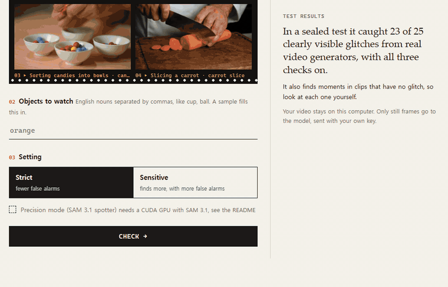

<div align="center">

# Lost & Frame

**English** · [한국어](README.ko.md)

### AI video generators often lose track of objects. A mug appears on a table nobody touched, or a log is gone from the fireplace one frame later.

### Lost & Frame finds the moments where an object disappears or appears without a visible cause. Each moment comes with two frames to compare and the model's one-sentence reason.



*Checking the juggling sample on the strict setting, without a key. Blink flips between frames 98 and 102, where three oranges become one in 0.17 s.*

### For people who publish AI-generated video, and for teams that compare video models or filter generated clips. It narrows the 120 frames of a 5-second clip to a few moments for a person to check.

### The app runs locally. The video stays on the computer; only still frames go to the model, with the user's own key, which never reaches the web page.

</div>

## How it works

Three checks examine the clip in different ways, and each misses different cases. This document calls them witnesses.

| Witness | What it does | What it misses |
|---|---|---|
| Scene judge | Every 16 frames, Muse Spark looks at eight frames spread over ±15 frames. It says whether the object disappeared, appeared or changed with no visible cause, such as a hand, the frame edge, something in front, a camera move or a cut. | One change among many similar objects. It also explains some real changes away. |
| Counter | Looks at the same frames but first counts the object in each one, so a drop from three mugs to two is written down. | Objects it does not see at all. |
| Spotter (precision mode) | Runs SAM 3.1's detector without its tracker memory and keeps the weak detections SAM usually throws away, to find where one copy came or went. The counter then looks at that spot, zoomed in. It only runs where the other two found nothing. | Needs a GPU. Does not help when the extra copy merges into a larger object. |

A witness raises an alert when it is confident enough: 90% on the strict setting and 50% on the sensitive one. Alerts of the same kind within 5 frames count as one moment.

## Results

Each test set and its scoring rule were fixed before the first run (pre-registered), and each set was scored once. The counts are glitches that a blind visual review marked as clearly visible in the frames, caught on the sensitive setting.

| Test set | Scene judge only | + Counter | All three |
|---|---|---|---|
| Real generator glitches (Physion-Eval and DeepTraceReward, 25 clearly visible) | 20 (80%) | 22 (88%) | 23 (92%, 95% CI 74–99) |
| Real, including likely visible (126) | 75 (60%) | 92 (73%) | 99 (79%) |
| Copy glitches added to clips the method had not seen (140 clearly visible) | 131 (94%) | 134 (96%) | 135 (96%, 95% CI 92–99) |

With a Meta Model API key, the model is Muse Spark 1.3, which was tested in its own sealed runs. On the same real set it caught 23 of 25 clearly visible glitches and 105 of 126 including likely visible ones. On the copy set it caught 138 of 140 (98.6%), with more false alarms than Muse Spark Open.

### Limits

- Most glitches that experts labelled cannot be seen in still frames. Lost & Frame catches those no better than chance.
- On 64 new clips with no glitch (Muse Spark 1.3), 52% of clips got at least one moment on the strict setting, about 1.2 moments per clip, and 70% got one on the sensitive setting. Many were kneading hands, clouds or camera pans. Each moment should be inspected before it is treated as a glitch.
- 25 real glitches is a small sample. The 95% interval runs from 74% to 99%.

[RESEARCH.md](RESEARCH.md) has the full record, including the ideas that failed.

## Run it

You need Node.js 22.9 or newer, and ffmpeg. ffmpeg must be on PATH, or `FFMPEG` and `FFPROBE` must be set in a file named `ffmpeg.env`. To install ffmpeg:

- Windows: `winget install Gyan.FFmpeg.Essentials`, then open a new terminal
- macOS: `brew install ffmpeg`
- Debian and Ubuntu: `sudo apt install ffmpeg`

```bash
git clone https://github.com/YAMMYHONEY/lost-and-frame.git
cd lost-and-frame
node --env-file-if-exists=.env --env-file-if-exists=ffmpeg.env app.mjs
```

Then open http://localhost:8787. On Windows, double-clicking `start-app.cmd` does the same. Nothing is installed with npm, because the app uses only Node's standard library. A switch at the top right changes the page between English and Korean.

### Without a key

Without a `.env` file, the four samples can still be checked. Pick one under "or pick a sample" and press Check. The model's answers for the samples are saved in `samples/raw`, so the whole check runs without calling a model, from extracting frames to the review page. Other clips require a key.

The samples are 5-second clips made for this repository with LTX-2.5 (Lightricks) on its official Hugging Face Space, using `research/ltx_samples.mjs`. Their prompts and seeds are in `samples/samples.json`, and they are under the [LTX-2.x Community License](https://github.com/Lightricks/LTX-2/blob/main/LICENSE-2_x). They show things generators often get wrong, such as similar-looking objects and hands.

| Sample | Objects to watch | Moments found (sensitive) |
|---|---|---|
| Three cups and a ball | cup, ball | 5 |
| Juggling oranges | orange | 9 |
| Sorting candies into bowls | candy, bowl | 5 |
| Slicing a carrot | carrot slice | 4 |

These clips have no labels. Some of the moments are real glitches and some are false alarms. The model's reason sometimes describes something the two frames do not show. The user decides which is which on the review page.

### With your own key

Copy the example file and fill in one key.

```bash
cp .env.example .env
```

- `BASETEN_API_KEY` for Muse Spark Open on Baseten, the model used in the sealed tests above.
- `MODEL_API_KEY` for the Meta Model API (Muse Spark 1.3). It uses the same prompts and steps, and was tested in separate sealed runs (the Muse Spark 1.3 results above).

A 5–10 second clip costs about $0.12 per watched object: two model calls per window, and a window every 16 frames. Checking the same clip again costs nothing, because answers are saved by content in `clips/raw`. The app refuses a clip that would need more than 300 calls.

### Precision mode (optional, needs a GPU)

The spotter runs SAM 3.1 locally. It needs:

- an NVIDIA GPU with about 8 GB of memory
- Python with PyTorch (CUDA) and OpenCV
- SAM 3.1 installed from its official repository (`sam3`, tested at commit `f1647e8`), with its weights from Hugging Face, which require accepting Meta's license

On Windows it needed four small fixes, written up in RESEARCH.md under 10-29:

- There is no Triton.
- The 3.1 model rejects one argument.
- The detector batch size has to be 1 on 8 GB.
- One attention kernel needs a fallback.

Set `PYTHON` in `.env` to that environment. The precision checkbox turns on when `import cv2, sam3, torch` works with CUDA. It adds about a minute per object, and about $0.01.

## Tests

```bash
node --test
```

The analysis tests compare window placement and alert positions with the research code, and run a generated clip from start to finish on saved answers, without the network.

## Repository

| Path | What |
|---|---|
| `app.mjs` | The local web app |
| `fuse.mjs` | VC-Fuse: windows, the three witnesses, alerts and moments |
| `video.mjs`, `report.mjs` | ffmpeg helpers; page styles and the review page |
| `spark.mjs`, `spark_open.mjs`, `budget.mjs` | Muse Spark clients (Meta API, Baseten) and the spending ledger with its stop line |
| `research/` | All experiment scripts: judges (`verify.mjs`), tiling, the spotter (`detect.py`, `count_change.py`, `evidence.py`, `steps_prep.py`), scoring (`eval_tile.py`), audits, and the first method, SAM tracking (`analyze.mjs`, `eval.mjs`) |
| `RESEARCH.md` | Lab notebook in Korean, with every hypothesis, pre-registration and result, including failures |
| `samples/` | Sample clips and their saved model answers |

The datasets are not in this repository. To reproduce the research, download them from the sources below with `research/zipfetch.mjs`, which pulls single files out of the remote archives. Research scripts write their outputs to a short work folder set by `VC_WORK` (default `work/`).

## Data and credits

- **Physion-Eval**: Zhang et al., *Physion-Eval*, arXiv 2603.19607 (2026), https://huggingface.co/datasets/PhysionLabs/Physion-Eval. Used only for evaluation. This repository has none of its videos, frames or labels.
- **DeepTraceReward**: *Learning Human-Perceived Fakeness in AI-Generated Videos via Multimodal LLMs*, arXiv 2509.22646 (NeurIPS 2025), https://huggingface.co/datasets/DeepTraceReward/RewardData (Apache-2.0). Used only for evaluation.
- **SAM 3 / 3.1**: Meta, *SAM 3: Segment Anything with Concepts*, arXiv 2511.16719, used under its own license.
- **Muse Spark**: Meta's models, called through Baseten or the Meta Model API with the user's key.

## License

The code is under the MIT License ([LICENSE](LICENSE)). The sample clips in `samples/`, and their frames in the demo GIFs in `docs/`, are AI-generated with LTX-2.5 and follow the LTX-2.x Community License linked above. SAM 3.1 and the datasets keep their own licenses.
